# CRM Ventas

CRM B2B para empresas ecuatorianas: pipeline kanban, cotizaciones en PDF con IVA del SRI, forecast de ventas y cumplimiento real de la **LOPDP**, con registro de consentimientos, derechos del titular y un log inmutable de accesos a datos personales.


**Demo:** pendiente de publicar (guía paso a paso en [docs/despliegue.md](docs/despliegue.md)).
**Usuarios de prueba** (datos 100 % ficticios, sin rol de administrador):

| Usuario | Rol | Qué ve |
|---|---|---|
| `gerente@example.com` | Gerente comercial | Todo el equipo, forecast por vendedor, privacidad LOPDP |
| `vendedor1@example.com` | Vendedor | Solo sus empresas, contactos, oportunidades y cotizaciones |

Contraseña de ambos: `Demo-CRM-2026`. La demo gratuita "duerme": la primera carga puede tardar ~1 minuto.

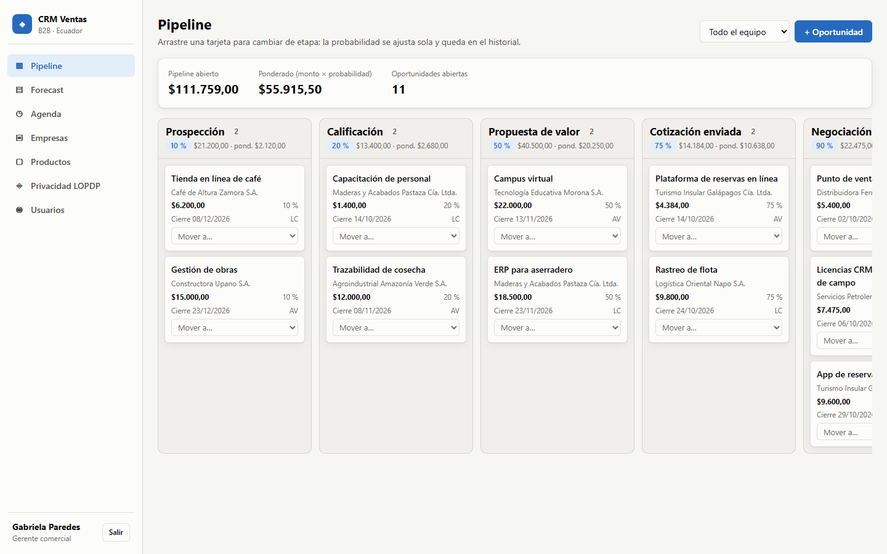

| Forecast de ventas | Cotización con IVA por tarifa |
|---|---|
| 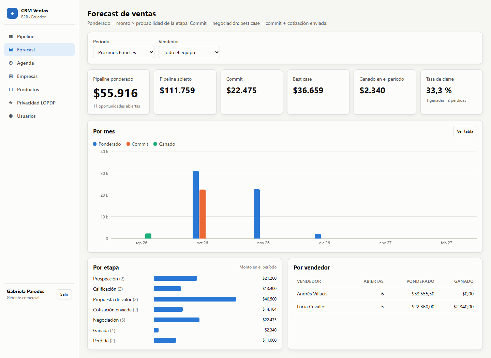 | 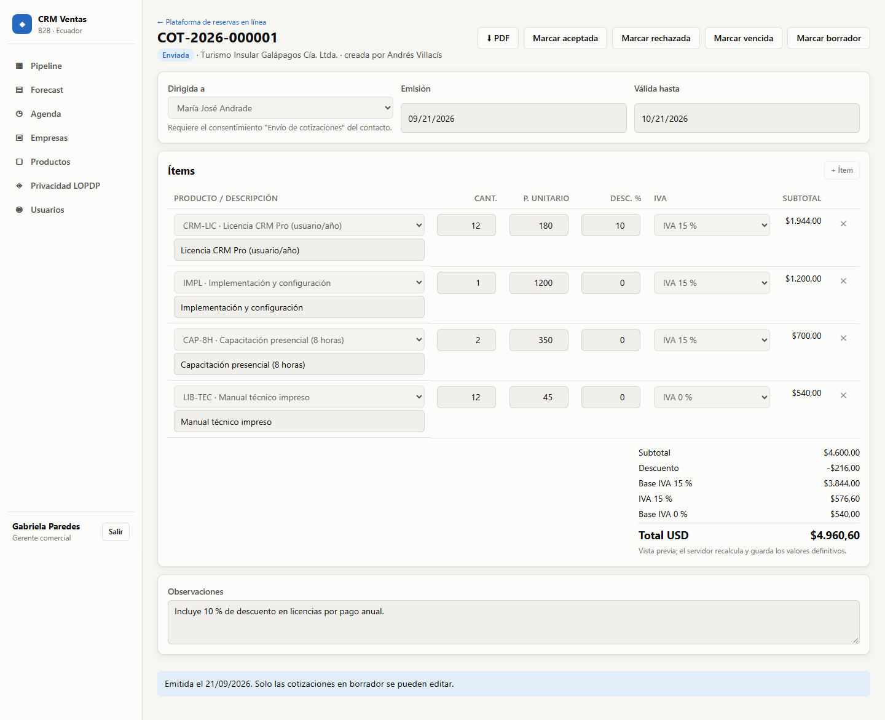 |
| **RUC validado con las reglas del SRI** (sociedad con secuencial de 7 dígitos) | **Alta de contacto: cédula validada y consentimiento obligatorio** |
| 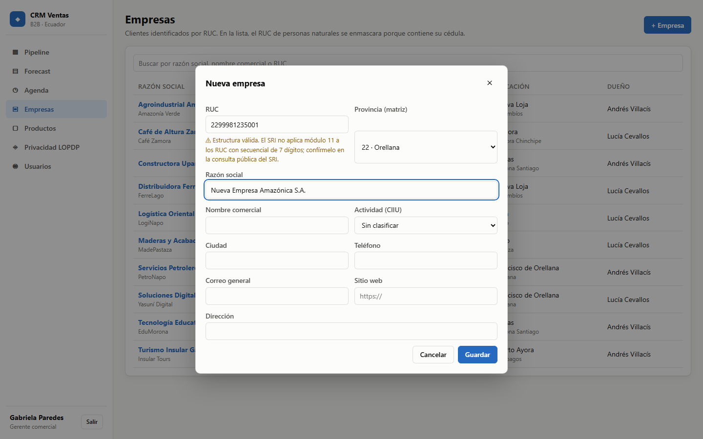 | 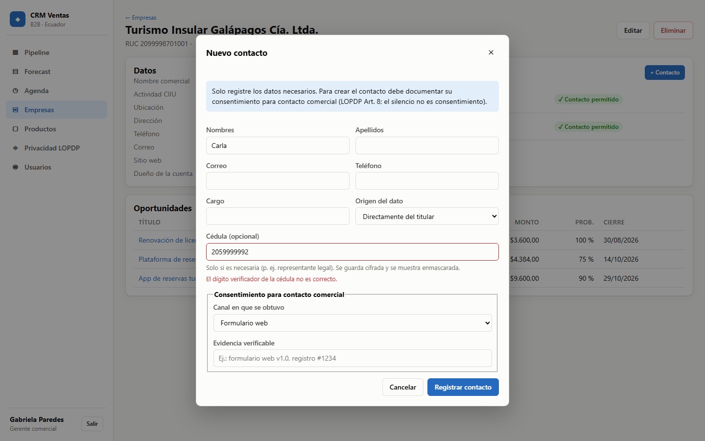 |
| **Consentimientos por finalidad y derechos del titular** | **Log de accesos, incluidos los intentos denegados** |
| 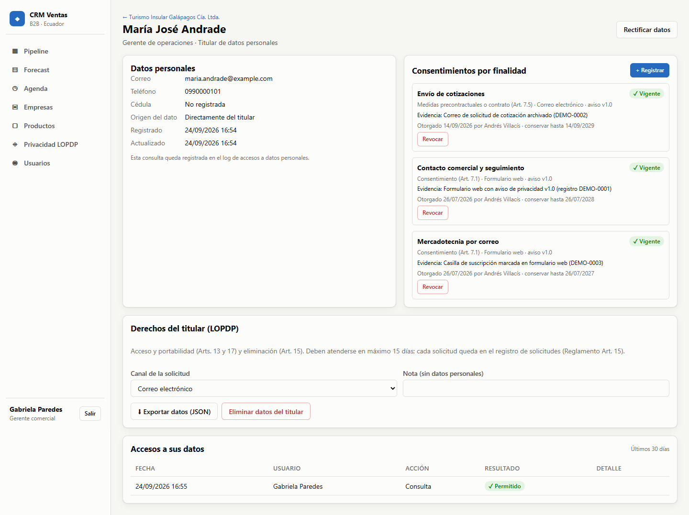 | 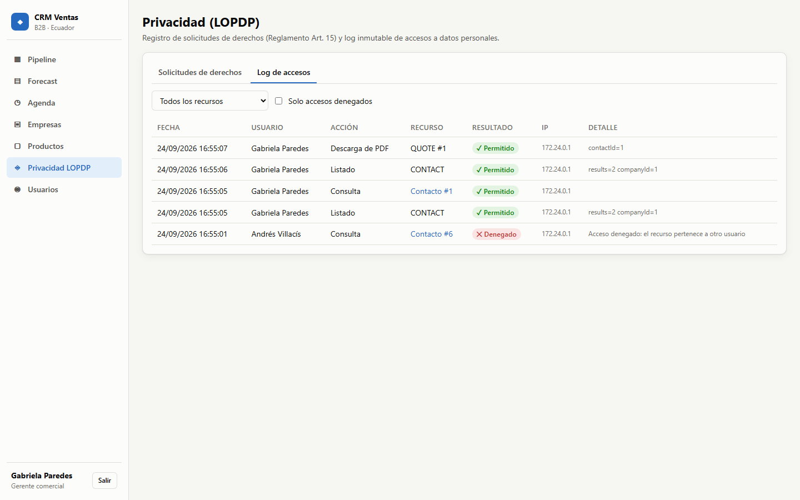 |
| **PDF de la cotización (OpenPDF)** | **API documentada con OpenAPI** |
| 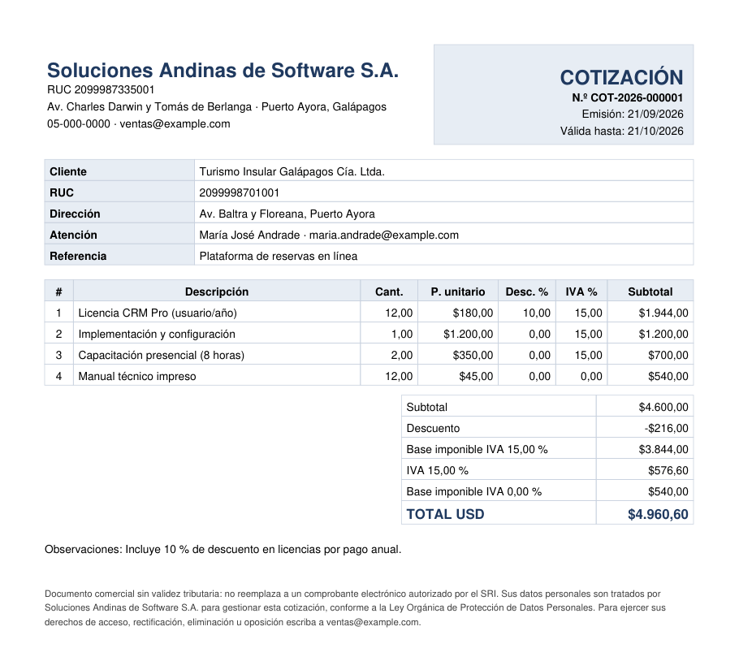 | 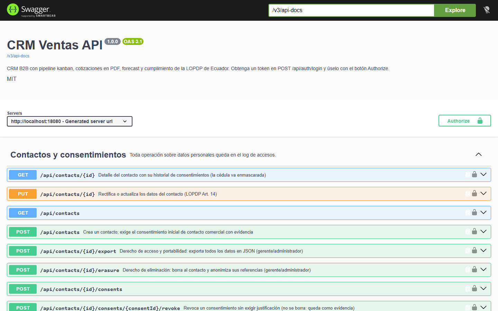 |
| **Modo oscuro** | **Diseño adaptable (móvil)** |
| 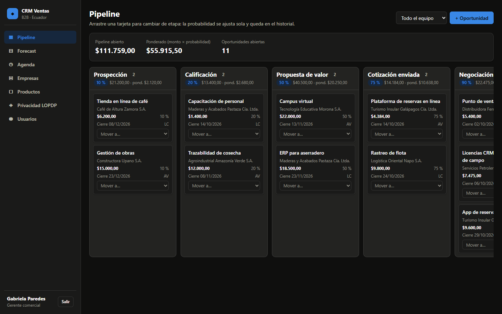 | 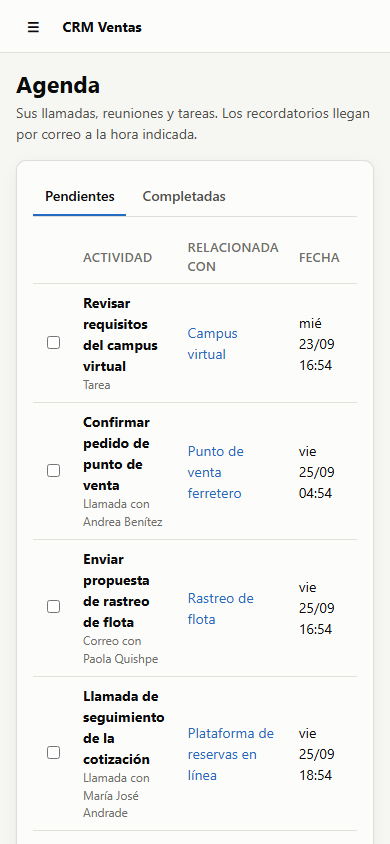 |

## Problema que resuelve

Las pymes B2B de Ecuador suelen llevar clientes y cotizaciones en hojas de cálculo. Así no saben cuánto van a vender este trimestre y, desde la vigencia plena de la **Ley Orgánica de Protección de Datos Personales** (2021) y su **Reglamento** (2023), no pueden demostrar con qué consentimiento tratan los datos de sus contactos ni atender en 15 días una solicitud de acceso o eliminación. Este CRM ordena el ciclo comercial (empresa → oportunidad → cotización → cierre) y convierte las obligaciones de la LOPDP en funciones del sistema.

## Funcionalidades

- **Empresas con RUC validado** según las reglas del SRI, incluida la excepción oficial para RUC nuevos de sociedades que ya no cumplen el módulo 11. El tipo de contribuyente se deriva del RUC.
- **Contactos con consentimiento por finalidad**: no se puede registrar a una persona sin documentar canal, evidencia y versión del aviso de privacidad. Revocar no borra la evidencia.
- **Cédula opcional cifrada** con AES-256-GCM y siempre enmascarada en la API (`******9991`).
- **Kanban con drag and drop** (Angular CDK): la probabilidad se ajusta según la etapa, queda historial y hay bloqueo optimista para ediciones concurrentes.
- **Cotizaciones** con numeración `COT-AAAA-NNNNNN`, descuentos, IVA por tarifa del SRI (15 %, 5 %, 0 %) calculado en el servidor y **PDF** con OpenPDF.
- **Actividades con recordatorios por correo**: Mailpit en local, API de Brevo en producción. Un cron de GitHub Actions despierta la API gratuita.
- **Dashboard de forecast**: pipeline, ponderado (monto × probabilidad), commit, best case, ganado y tasa de cierre, por mes, etapa y vendedor.
- **Derechos del titular**: exportación JSON (acceso y portabilidad) y eliminación con anonimización. Cada solicitud queda registrada con su plazo de 15 días.
- **Log inmutable de accesos** a datos personales: consultas, cambios, exportaciones, descargas de PDF e intentos denegados. PostgreSQL rechaza UPDATE/DELETE sobre esa tabla.
- **Roles**: el vendedor ve lo suyo; gerente y administrador ven todo.

## Arquitectura

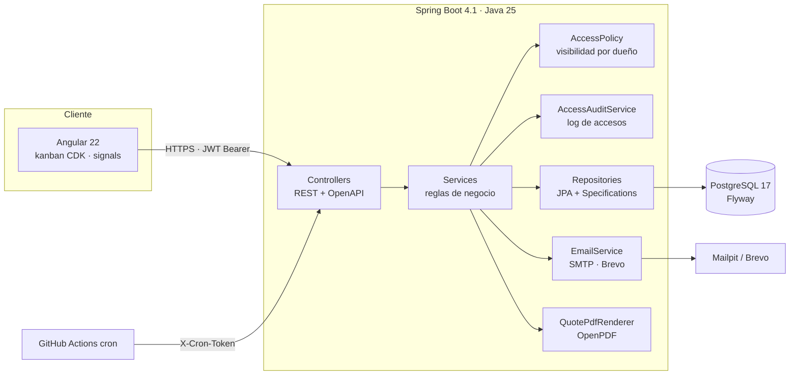

Capas: `controller` → `service` → `repository`, con `dto` (records validados), `mapper`, `exception` (ProblemDetail RFC 9457), `security`, `validation` y `domain`.

## Stack y por qué

| Capa | Tecnología | Motivo |
|---|---|---|
| Backend | Java 25 LTS, **Spring Boot 4.1.1** | La rama 3.5 perdió soporte OSS el 30-jun-2026; 4.1 es la última estable, con soporte hasta jul-2027 |
| Seguridad | Spring Security 7 + JWT HS256 (Nimbus) | Resource server estándar sin librerías extra; el rol se consulta en BD en cada petición |
| Persistencia | PostgreSQL 17, Flyway 12, Hibernate 7 (`ddl-auto=validate`) | El esquema lo gobiernan las migraciones versionadas; Hibernate solo valida |
| PDF | OpenPDF 3.0.5 | Licencia LGPL/MPL, sin dependencias nativas |
| Frontend | Angular 22 (zoneless, signals), Angular CDK | Drag and drop accesible y cambio de detección sin zone.js |
| Tests | JUnit 6, Mockito, Testcontainers 2, JaCoCo · Vitest · Playwright | Integración contra PostgreSQL real y e2e del stack completo |
| DevOps | Docker multi-stage, docker compose, GitHub Actions | Un comando para levantar todo; CI con gitleaks, tests y e2e |
| Despliegue | Render (API) + Neon (BD) + Vercel (web) + Brevo (correo) | Planes gratuitos con límites verificados |

## Modelo de datos

Derivado de las fuentes oficiales documentadas en [docs/investigacion.md](docs/investigacion.md). El detalle de cada columna, con la regla que la justifica, está en [docs/modelo-datos.md](docs/modelo-datos.md).

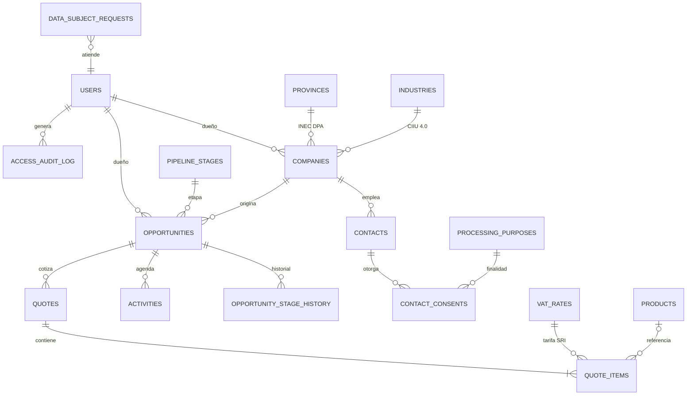

## Ejecutar en local

### Con Docker (recomendado)

```bash
./scripts/init-env.sh        # crea .env con secretos aleatorios (openssl)
docker compose up --build    # PostgreSQL + Mailpit + API + web, con datos demo
```

| Servicio | URL |
|---|---|
| Aplicación | http://localhost:8081 |
| API + Swagger | http://localhost:8080/swagger-ui.html |
| Correos capturados (Mailpit) | http://localhost:8025 |

Si esos puertos están ocupados, defina `API_HOST_PORT`, `WEB_HOST_PORT` o `MAIL_UI_HOST_PORT` en `.env`.

### Sin Docker

Requisitos: JDK 25+, Maven 3.9+, Node 24 LTS y PostgreSQL 17 local con una base `crm`.

```bash
# API (exporte primero las variables de .env.example; SPRING_PROFILES_ACTIVE=demo carga los datos demo)
cd backend && mvn spring-boot:run

# Web (proxy /api -> localhost:8080)
cd frontend && npm ci && npm start    # http://localhost:4200
```

## Variables de entorno

| Variable | Descripción | Obligatoria |
|---|---|---|
| `DB_URL` / `DB_USER` / `DB_PASSWORD` | Conexión a PostgreSQL | Sí |
| `JWT_SECRET` | Firma HS256, ≥ 32 bytes aleatorios | Sí |
| `DATA_ENCRYPTION_KEY` | Clave AES-256 en Base64 (32 bytes) para cifrar la cédula | Sí |
| `CRON_TOKEN` | Token del cron externo de recordatorios, ≥ 32 bytes | Sí |
| `CORS_ALLOWED_ORIGINS` | Orígenes permitidos separados por coma (sin `*`) | Sí |
| `JWT_TTL` | Duración del token (ISO-8601, máx. 2 h; por defecto 30 min) | No |
| `SPRING_PROFILES_ACTIVE` | `demo` carga datos ficticios | No |
| `ADMIN_EMAIL` / `ADMIN_PASSWORD` | Crea el primer administrador si no existe | No |
| `MAIL_PROVIDER` | `log`, `smtp` o `brevo` | No |
| `MAIL_FROM` / `BREVO_API_KEY` | Remitente verificado y clave de Brevo | Solo con `brevo` |
| `FRONTEND_URL` | Enlace incluido en los correos | No |
| `API_DOCS_ENABLED` | Publica Swagger (por defecto `true`) | No |

Si falta un secreto o es débil, la aplicación **no arranca** y docker compose se detiene con un mensaje.

## API

Documentación interactiva: `http://localhost:8080/swagger-ui.html`. Ejemplos listos en [docs/api.http](docs/api.http).

| Método | Ruta | Descripción |
|---|---|---|
| POST | `/api/auth/login` | JWT de 30 min (5 intentos fallidos / 15 min) |
| GET | `/api/catalogs` | Provincias INEC, CIIU, IVA SRI, etapas, finalidades LOPDP |
| POST | `/api/validation/identification` | Valida cédula o RUC |
| GET/POST/PUT | `/api/companies` | Empresas (el vendedor ve las suyas) |
| GET/POST/PUT | `/api/contacts` | Contactos con consentimiento inicial obligatorio |
| POST | `/api/contacts/{id}/consents` · `/consents/{cid}/revoke` | Otorgar y revocar consentimientos |
| POST | `/api/contacts/{id}/export` | Derecho de acceso y portabilidad (JSON) |
| POST | `/api/contacts/{id}/erasure` | Derecho de eliminación |
| GET | `/api/opportunities/board` | Tablero kanban |
| PATCH | `/api/opportunities/{id}/stage` | Mover de etapa (bloqueo optimista) |
| GET/POST/PUT | `/api/activities` | Agenda con recordatorios |
| POST/PUT/PATCH | `/api/quotes` | Cotizaciones y cambio de estado |
| GET | `/api/quotes/{id}/pdf` | PDF de la cotización |
| GET | `/api/forecast?from=&to=` | Dashboard de forecast |
| GET | `/api/privacy/requests` · `/api/privacy/access-log` | Registro de solicitudes y log de accesos |

## Tests y cobertura

```bash
cd backend && mvn verify                   # 98 tests: unitarios + integración (Testcontainers) + JaCoCo ≥ 70 %
cd frontend && npm test -- --watch=false    # 15 tests Vitest
cd frontend && npx playwright test          # 5 e2e contra docker compose (E2E_BASE_URL)
```

| Suite | Resultado |
|---|---|
| Backend | 98 tests en verde; **cobertura de líneas 85,6 %** en servicios, validación, seguridad y mappers (validación de cédula/RUC: 97,8 %) |
| Frontend | 15 tests (validador de identificación, cálculo de cotización, sesión e interceptores) |
| E2E | 5 flujos: roles, validación de RUC, drag and drop del kanban y cotización con PDF |

Criterios de aceptación cubiertos por tests: `EcuadorianIdValidatorTest` (cédula y RUC, con el ejemplo oficial del SRI) y `RoleVisibilityIntegrationTest` (el vendedor ve lo suyo, el gerente ve todo, y el acceso ajeno se registra como denegado).

## Despliegue

| Servicio | Qué corre | Límite gratuito relevante |
|---|---|---|
| Render | API (Docker, `render.yaml`) | Duerme tras 15 min; 750 h/mes; sin SMTP |
| Neon | PostgreSQL 17 | 0,5 GB y 100 CU-h por proyecto |
| Vercel | Angular (`frontend/vercel.json`) | Uso personal/no comercial |
| Brevo | Correo transaccional por API | 300 correos/día |
| GitHub Actions | CI y cron de recordatorios | Gratuito en repos públicos |

Pasos detallados en [docs/despliegue.md](docs/despliegue.md).

## Seguridad aplicada

- **Deny-by-default**: todo exige JWT salvo login, health y documentación. Hay reglas por rol (BFLA) y un chequeo por objeto en los servicios (BOLA): un objeto ajeno responde 404 y queda en el log.
- **JWT HS256** de 30 min firmado con un secreto ≥ 256 bits (RFC 7518). El token solo lleva el ID: rol y estado se leen de la BD en cada petición, así que desactivar a un usuario tiene efecto inmediato.
- **Contraseñas BCrypt** (factor 12, máx. 72 caracteres). El login hace una comparación simulada para no revelar qué correos existen y tiene **rate limiting** por cuenta y por IP (429 + `Retry-After`).
- **Secretos solo por entorno**, sin valores por defecto; las propiedades se validan al arrancar. CORS con orígenes explícitos (se rechaza `*`).
- **Cifrado AES-256-GCM** de la cédula con prefijo de versión para rotar la clave. Log de accesos **append-only** protegido con un trigger.
- **Validación** con Bean Validation en todos los DTOs; los totales de cotizaciones los calcula siempre el servidor, sin *mass assignment*. Solo SQL parametrizado (JPA y Specifications).
- **Errores** como ProblemDetail, sin trazas; los 500 llevan un ID de incidente. Actuator expone solo `health`.
- **Cabeceras**: CSP estricta (sin scripts inline; *critical CSS inlining* desactivado por eso), HSTS, `X-Frame-Options: DENY`, `Referrer-Policy: no-referrer`, `Permissions-Policy`.
- **Docker**: imágenes multi-stage con versión fija, usuario no root y healthcheck. **CI**: gitleaks sobre todo el historial, acciones fijadas por SHA, `permissions: contents: read`. Dependabot activo.
- **LOPDP**: consentimiento por finalidad con evidencia, derechos del titular en 15 días con registro de solicitudes, minimización (enmascaramiento), datos demo ficticios y ningún correo real a dominios de ejemplo.

## Decisiones técnicas

- **RUC de sociedades sin módulo 11 estricto** → el SRI comunicó que los RUC con secuencial de 7 dígitos no tienen algoritmo público; rechazarlos bloquearía empresas reales. Se valida la estructura y el verificador se muestra como advertencia.
- **Log de accesos en la misma transacción** → si la operación falla, no queda un registro falso de éxito. Los intentos denegados se registran aparte (transacción nueva desde el manejador de errores), sin anidar conexiones.
- **Consentimiento como registro histórico, no como booleano** → la LOPDP exige demostrarlo y la revocatoria no es retroactiva, así que se guarda quién, cuándo, cómo y con qué evidencia.
- **Correo por API HTTPS en producción** → Render free bloquea SMTP. La interfaz `EmailSender` permite usar Mailpit en local y Brevo en la nube sin cambiar el código.
- **Cron externo + `SKIP LOCKED`** → la instancia gratuita duerme; GitHub Actions la despierta y el bloqueo evita correos duplicados si coincide con el job interno.
- **IVA como catálogo** → la tarifa cambia por decreto (Circular SRI dic-2025) y cada ítem guarda la tarifa aplicada, así una cotización antigua no cambia.
- **Token en `sessionStorage`** en lugar de cookie → frontend y API están en dominios distintos (cookies de terceros bloqueadas); la CSP estricta y el TTL corto mitigan el riesgo de XSS.
- **Spring Boot 4.1 en vez de 3.x** → la rama 3.5 ya no recibe parches OSS (OWASP A03, cadena de suministro).

## Roadmap

- [ ] Rotación de `DATA_ENCRYPTION_KEY` con re-cifrado por lotes (el formato `v1:` ya lo permite).
- [ ] Refresh tokens con rotación y revocación.
- [ ] Rate limiting distribuido (Redis) para más de una instancia.
- [ ] Alertas de consentimientos por vencer y revisión periódica de plazos de conservación.
- [ ] Envío de la cotización por correo desde el sistema, con el PDF adjunto.
- [ ] Emisión de facturas electrónicas con el esquema offline del SRI (requiere firma electrónica).

## Fuentes de datos y licencias

- **LOPDP** (Registro Oficial 459, 2021) y **Reglamento** (Decreto 904, 2023): normativa pública de Ecuador.
- **SRI**: ficha técnica de comprobantes electrónicos v2.32 (tipos de identificación y tarifas de IVA), guía del RUC, circular NAC-DGECCGC25-00000006 y comunicado sobre la generación de RUC.
- **INEC**: División Político Administrativa y CIIU Rev. 4.0 (información pública).
- **Registro Civil**: código 30 de cédulas emitidas en el exterior.
- Tabla completa de fuentes, URLs y fechas de consulta en [docs/investigacion.md](docs/investigacion.md).
- Los datos demo son **ficticios**: nombres inventados, correos `@example.com` (RFC 2606) y RUC sintéticos.
- Código bajo licencia [MIT](LICENSE).

## Autor

**Diego Francisco Granda Zhingre** · [GitHub](https://github.com/DiegoFranciscoG)
