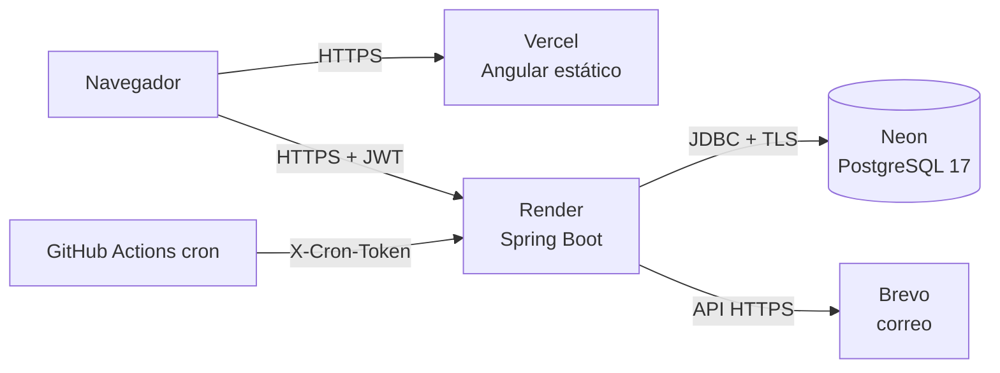

# Despliegue 100 % gratuito

| Pieza | Servicio | Plan | Límites verificados (docs/investigacion.md) |
|---|---|---|---|
| Base de datos | **Neon** (PostgreSQL 17) | Free | 0,5 GB y 100 CU-h por proyecto; se suspende tras 5 min sin uso (#13) |
| API | **Render** (web service Docker) | Free | Se duerme tras 15 min sin tráfico (~1 min en despertar); 750 h/mes por workspace; sin SMTP saliente (#11, #12) |
| Frontend | **Vercel** | Hobby | 100 GB/mes de transferencia; solo uso personal/no comercial (#14) |
| Correo | **Brevo** (API HTTPS) | Free | 300 correos/día tras la aprobación de la cuenta (#15, #16) |
| Recordatorios | **GitHub Actions** (cron) | Gratis en repos públicos | Cada hora en horario laboral; GitHub pausa los cron tras 60 días sin actividad en el repo |

Las páginas de planes consultadas no mencionan tarjeta de crédito para estos niveles gratuitos. Si algún servicio la pide al registrarse, deténgase y revíselo antes de continuar.

## 1. Neon (base de datos)

1. Cree un proyecto en https://neon.com con PostgreSQL 17, en la región **AWS us-east-1** (cerca de la región `virginia` de Render).
2. En *Connection details* copie la cadena **directa** (sin `-pooler`): Flyway y el pool de Hikari funcionan mejor sin PgBouncer en una sola instancia.
3. Arme las variables:
   - `DB_URL` = `jdbc:postgresql://<host>/<base>?sslmode=require`
   - `DB_USER` y `DB_PASSWORD` = usuario y contraseña del rol de Neon.

## 2. Render (API)

1. Suba el repositorio a GitHub (paso manual del autor).
2. En Render: **New → Blueprint** y elija el repositorio. Render lee `render.yaml`.
3. Complete las variables marcadas `sync: false`:
   - `DB_URL`, `DB_USER`, `DB_PASSWORD` (de Neon).
   - `CORS_ALLOWED_ORIGINS` y `FRONTEND_URL` = URL de Vercel (paso 3); puede volver a ellas después.
   - `ADMIN_EMAIL` / `ADMIN_PASSWORD` (opcional; contraseña de 12 a 72 caracteres).
4. `JWT_SECRET`, `DATA_ENCRYPTION_KEY` y `CRON_TOKEN` los **genera Render** (256 bits aleatorios). Copie `CRON_TOKEN` para el paso 5.
5. El perfil `demo` carga los datos ficticios. Para una instalación real, quite `SPRING_PROFILES_ACTIVE=demo` **antes del primer arranque**.
6. Verifique `https://<servicio>.onrender.com/actuator/health` → `{"status":"UP"}` y Swagger en `/swagger-ui.html`.

La imagen limita el heap al 75 % de la memoria del contenedor (`-XX:MaxRAMPercentage=75`, GC serial) para entrar en los 512 MB del plan free.

## 3. Vercel (frontend)

1. **Add New → Project**, importe el repositorio y ponga **Root Directory = `frontend`**. `vercel.json` ya define build, salida y cabeceras.
2. Variable de entorno `API_URL` = `https://<servicio>.onrender.com` (sin barra final). El script `scripts/write-config.mjs` la escribe en `config.json` durante el build.
3. Despliegue y copie la URL (`https://<proyecto>.vercel.app`) en `CORS_ALLOWED_ORIGINS` y `FRONTEND_URL` de Render.

La CSP de Vercel permite `connect-src` solo hacia `'self'` y `https://*.onrender.com`. Si usa otro dominio para el API, ajuste `vercel.json`.

## 4. Brevo (correo de recordatorios)

1. Cree la cuenta gratuita y espere la aprobación para envío.
2. Verifique el remitente (*Senders & IP*) y cree una **API key** (*SMTP & API → API keys*).
3. En Render: `MAIL_PROVIDER=brevo`, `BREVO_API_KEY=<clave>`, `MAIL_FROM=<remitente verificado>`.

Con datos demo, los usuarios tienen correos `@example.com` (RFC 2606): el sistema **no** los envía, para no generar rebotes. Para probar, cree un usuario con su correo real.

## 5. GitHub Actions (cron de recordatorios)

En el repositorio: **Settings → Secrets and variables → Actions**
- Variable `API_URL` = `https://<servicio>.onrender.com`
- Secret `CRON_TOKEN` = el valor generado por Render.

El workflow `.github/workflows/reminders.yml` se ejecuta cada hora entre las 08:00 y las 20:00 (hora de Ecuador) de lunes a viernes. Despierta la API y despacha los recordatorios vencidos. `FOR UPDATE SKIP LOCKED` evita correos duplicados si coincide con el job interno.

## Consideraciones de la LOPDP en producción

- **Transferencia internacional** (LOPDP Arts. 55-56): Render, Neon (EE. UU.) y Brevo (UE) están fuera de Ecuador. Con datos reales, el aviso de privacidad debe informarlo, y los proveedores actúan como **encargados del tratamiento** (Art. 47 num. 10-11).
- **Solo datos ficticios en la demo**: correos `@example.com`, RUC sintéticos y ninguna cédula.
- Guarde `DATA_ENCRYPTION_KEY` en un gestor de secretos: sin ella, las cédulas cifradas son irrecuperables.
