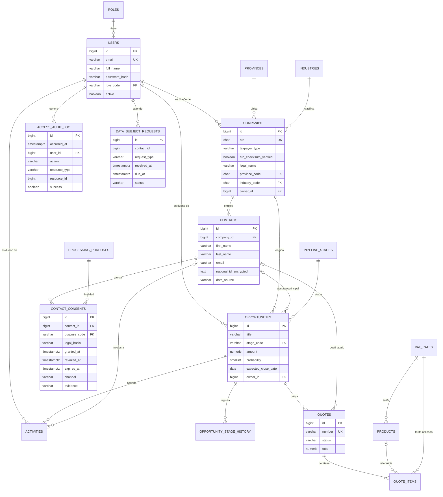

# Modelo de datos

Derivado de [investigacion.md](investigacion.md). La columna "Regla / fuente" cita el número de fuente (`#n`) o el supuesto (`Sn`). Motor: PostgreSQL 17. Migraciones: Flyway (`backend/src/main/resources/db/migration`). Datos demo ficticios en `db/demo`, que solo se cargan con `APP_DEMO_DATA=true`.

Convenciones:
- Nombres de tablas y columnas en inglés, `snake_case`. PK `bigint GENERATED ALWAYS AS IDENTITY`.
- Fechas y horas en `timestamptz` (UTC). La interfaz muestra `America/Guayaquil`.
- Dinero en `numeric(14,2)` y en Java `BigDecimal`, con redondeo `HALF_UP` a 2 decimales. Moneda USD.
- Emails guardados en minúsculas, con unicidad sobre el valor normalizado.

## Diagrama ER

## Catálogos oficiales y de negocio

| Tabla | Campo | Tipo | Restricción | Regla / fuente |
|---|---|---|---|---|
| `roles` | `code` | varchar(20) | PK: `ADMIN`, `MANAGER`, `SALES_REP` | Enunciado: "el vendedor ve lo suyo, el gerente ve todo" |
| `provinces` | `code` | char(2) | PK: `01`…`24`, `90` | INEC DPA #6 |
| `provinces` | `name` | varchar(60) | NOT NULL | #6 |
| `industries` | `code` | char(1) | PK: `A`…`U` | INEC CIIU Rev. 4.0 #25 |
| `vat_rates` | `code` | varchar(2) | PK: código SRI (0, 2, 3, 4, 5, 6, 7, 8, 10) | SRI Tabla 17 #7 |
| `vat_rates` | `percentage` | numeric(5,2) | 0 ≤ x ≤ 100 | #7, #8 |
| `vat_rates` | `active` | boolean | Solo 0, 4, 5, 6 y 7 se pueden usar en ítems nuevos | #8 (15 % vigente), S5 |
| `pipeline_stages` | `code` | varchar(30) | PK | #9 |
| `pipeline_stages` | `position` | smallint | UNIQUE (orden del kanban) | #9 |
| `pipeline_stages` | `default_probability` | smallint | 0-100 | #9: PROSPECTING 10, QUALIFICATION 20, VALUE_PROPOSITION 50, PROPOSAL 75, NEGOTIATION 90, CLOSED_WON 100, CLOSED_LOST 0 |
| `pipeline_stages` | `forecast_category` | varchar(20) | `PIPELINE`, `BEST_CASE`, `COMMIT`, `CLOSED`, `OMITTED` | #9, #10 |
| `pipeline_stages` | `closed`, `won` | boolean | `won` implica `closed` (CHECK) | #9 |
| `processing_purposes` | `code` | varchar(30) | PK: `COMMERCIAL_CONTACT`, `QUOTE_DELIVERY`, `EMAIL_MARKETING` | LOPDP Art. 8: consentimiento por finalidad #1 |
| `processing_purposes` | `legal_basis` | varchar(30) | Uno de los 8 numerales del Art. 7 | #1 Art. 7 |
| `processing_purposes` | `retention_months` | smallint | > 0 (24, 36 y 12) | #2 Arts. 8 y 10; S4 |

## Control y privacidad

| Tabla | Campo | Tipo | Restricción | Regla / fuente |
|---|---|---|---|---|
| `users` | `email` | varchar(254) | UNIQUE, en minúsculas | Login |
| `users` | `password_hash` | varchar(100) | BCrypt con factor 12 | OWASP #23 |
| `users` | `role_code` | varchar(20) | FK `roles` | Enunciado |
| `users` | `active` | boolean | Los usuarios no se borran, se desactivan (el log los referencia) | #1 Art. 10 k |
| `access_audit_log` | `occurred_at` | timestamptz | NOT NULL, default `now()` | #1 Art. 10 k; OWASP A09 #20 |
| `access_audit_log` | `user_id` | bigint | FK `users` | idem |
| `access_audit_log` | `action` | varchar(30) | `VIEW`, `LIST`, `CREATE`, `UPDATE`, `EXPORT`, `ERASE`, `CONSENT_GRANT`, `CONSENT_REVOKE`, `PDF_DOWNLOAD` | idem |
| `access_audit_log` | `resource_type` | varchar(30) | `CONTACT`, `COMPANY`, `QUOTE`, `DATA_SUBJECT_REQUEST` | idem |
| `access_audit_log` | `resource_id` | bigint | Sin FK: debe sobrevivir a la eliminación del titular | #1 Art. 15 |
| `access_audit_log` | `success` | boolean | `false` = intento denegado (BOLA) | OWASP API1 #21 |
| `access_audit_log` | `detail` | varchar(200) | **Sin datos personales** (solo IDs y conteos) | #1 Art. 10 e |
| `access_audit_log` | — | trigger | Rechaza `UPDATE` y `DELETE` (solo se puede insertar) | Integridad de la evidencia #1 Art. 10 k |
| `data_subject_requests` | `contact_id` | bigint | Sin FK (el contacto puede haber sido eliminado) | #2 Art. 15 |
| `data_subject_requests` | `request_type` | varchar(20) | `ACCESS`, `RECTIFICATION`, `ERASURE`, `OPPOSITION`, `PORTABILITY`, `SUSPENSION` | #1 Arts. 13-19 |
| `data_subject_requests` | `channel` | varchar(20) | `EMAIL`, `WEB_FORM`, `IN_PERSON`, `PHONE`, `LETTER` | #2 Art. 15 |
| `data_subject_requests` | `due_at` | timestamptz | `received_at + 15 días` | #1 Arts. 13-16; S2 |
| `data_subject_requests` | `status` | varchar(20) | `RECEIVED`, `COMPLETED`, `REJECTED` | #2 Art. 15 |
| `data_subject_requests` | `resolution` | varchar(500) | Detalle de la atención, sin datos personales | #2 Art. 15 |

## Clientes

| Tabla | Campo | Tipo | Restricción | Regla / fuente |
|---|---|---|---|---|
| `companies` | `ruc` | char(13) | UNIQUE; 13 dígitos; validado por `IdentificationValidator` | #3, #4, #5, #6 |
| `companies` | `taxpayer_type` | varchar(20) | `NATURAL_PERSON` (3.er dígito 0-5), `PUBLIC_ENTITY` (6), `PRIVATE_COMPANY` (9) | #3, #4 |
| `companies` | `ruc_checksum_verified` | boolean | `false` = estructura válida pero sin verificador aplicable (secuencial de 7 dígitos) | #3; S3 |
| `companies` | `legal_name` | varchar(300) | NOT NULL (razón social) | SRI #4 |
| `companies` | `trade_name` | varchar(300) | Opcional (nombre comercial) | — |
| `companies` | `province_code` | char(2) | FK `provinces` | #6 |
| `companies` | `industry_code` | char(1) | FK `industries` | #25 |
| `companies` | `owner_id` | bigint | FK `users`: el vendedor responsable de la cuenta | Enunciado (visibilidad) |
| `contacts` | `company_id` | bigint | FK `companies` ON DELETE RESTRICT | B2B |
| `contacts` | `first_name`, `last_name` | varchar(100) | NOT NULL | Minimización #1 Art. 10 e |
| `contacts` | `email`, `phone`, `job_title` | varchar | Opcionales; email con formato válido | #1 Art. 10 e |
| `contacts` | `national_id_encrypted` | text | Opcional; cédula validada con módulo 10 y **cifrada con AES-256-GCM** | #1 Art. 37; S1 |
| `contacts` | `data_source` | varchar(20) | `DIRECT`, `REFERRAL`, `EVENT`, `PUBLIC_SOURCE` | #1 Art. 12 num. 6 (origen del dato) |
| `contact_consents` | `purpose_code` | varchar(30) | FK `processing_purposes` | #1 Art. 8 |
| `contact_consents` | `legal_basis` | varchar(30) | Copia de la base de la finalidad al momento de registrar | #1 Art. 7 |
| `contact_consents` | `granted_at` | timestamptz | NOT NULL | #2 Art. 5 (demostrable) |
| `contact_consents` | `expires_at` | timestamptz | `granted_at + retention_months` | #2 Art. 10 |
| `contact_consents` | `revoked_at` | timestamptz | NULL = vigente; revocar no borra el registro | #1 Art. 8 (sin efecto retroactivo) |
| `contact_consents` | `channel` | varchar(20) | `WEB_FORM`, `EMAIL`, `IN_PERSON`, `PHONE_RECORDED`, `PAPER` | #2 Art. 5 |
| `contact_consents` | `evidence` | varchar(500) | NOT NULL: referencia verificable | #2 Art. 5 |
| `contact_consents` | `privacy_notice_version` | varchar(20) | NOT NULL | #1 Art. 12 |
| `contact_consents` | — | índice único parcial | Un solo consentimiento vigente por (contacto, finalidad) | #1 Art. 8 |

## Ventas

| Tabla | Campo | Tipo | Restricción | Regla / fuente |
|---|---|---|---|---|
| `products` | `sku` | varchar(40) | UNIQUE | — |
| `products` | `unit_price` | numeric(14,2) | ≥ 0 | — |
| `products` | `vat_rate_code` | varchar(2) | FK `vat_rates` (activa) | #7 |
| `opportunities` | `stage_code` | varchar(30) | FK `pipeline_stages` | #9 |
| `opportunities` | `amount` | numeric(14,2) | ≥ 0 | #10 |
| `opportunities` | `probability` | smallint | 0-100; al cambiar de etapa toma el valor por defecto de la nueva etapa; si la etapa está cerrada, queda fija (100/0) | #9 |
| `opportunities` | `expected_close_date` | date | NOT NULL (base del forecast mensual) | #10 |
| `opportunities` | `closed_at` | timestamptz | Obligatorio si la etapa está cerrada (CHECK en el servicio) | #9 |
| `opportunities` | `lost_reason` | varchar(300) | Obligatorio al pasar a `CLOSED_LOST` | Buenas prácticas de pipeline #9 |
| `opportunities` | `version` | bigint | Bloqueo optimista (drag and drop concurrente) | — |
| `opportunity_stage_history` | `from_stage`, `to_stage`, `changed_at`, `changed_by` | — | Se inserta en cada cambio de etapa | Auditoría del pipeline |
| `activities` | `type` | varchar(20) | `CALL`, `MEETING`, `EMAIL`, `TASK`, `NOTE` | — |
| `activities` | `due_at` | timestamptz | Opcional para `NOTE` | — |
| `activities` | `remind_at` | timestamptz | ≤ `due_at` (CHECK) | Recordatorios por email #15 |
| `activities` | `reminder_sent_at` | timestamptz | NULL = pendiente (índice parcial) | Idempotencia del envío |
| `activities` | `contact_id` | bigint | Requiere consentimiento `COMMERCIAL_CONTACT` vigente para llamadas, reuniones y emails | #1 Art. 8, #2 Art. 6 |
| `activities` | — | CHECK | Debe tener `company_id` u `opportunity_id` | — |
| `quotes` | `number` | varchar(20) | UNIQUE, `COT-AAAA-NNNNNN` (secuencia) | — |
| `quotes` | `status` | varchar(20) | `DRAFT`, `SENT`, `ACCEPTED`, `REJECTED`, `EXPIRED`; solo `DRAFT` es editable | — |
| `quotes` | `contact_id` | bigint | Requiere consentimiento `QUOTE_DELIVERY` vigente | #1 Art. 8 |
| `quotes` | `valid_until` | date | ≥ `issue_date` | — |
| `quotes` | `subtotal`, `discount_total`, `tax_total`, `total` | numeric(14,2) | Calculados en el servidor, nunca aceptados del cliente | OWASP API3 #21 |
| `quote_items` | `quantity` | numeric(12,2) | > 0 | — |
| `quote_items` | `discount_percent` | numeric(5,2) | 0-100 | — |
| `quote_items` | `vat_rate_code`, `vat_percentage` | — | Se copia la tarifa vigente del producto al crear (histórico estable) | #7, #8 |

## Cálculo de la cotización

Para cada ítem: `bruto = cantidad × precio`, `descuento = round(bruto × %desc / 100)`, `neto = bruto − descuento`, `iva = round(neto × %IVA / 100)`.
En la cotización: `subtotal = Σ bruto`, `discount_total = Σ descuento`, `tax_total = Σ iva`, `total = Σ neto + tax_total`. El PDF desglosa la base imponible por tarifa (15 %, 5 %, 0 %), igual que un comprobante del SRI (#7).

## Fórmulas del forecast

| Métrica | Fórmula | Fuente |
|---|---|---|
| Pipeline abierto | Σ `amount` de oportunidades abiertas con cierre en el período | #10 |
| Pipeline ponderado | Σ `amount × probability / 100` (abiertas) | #10 (weighted amount) |
| Commit | Σ `amount` de las abiertas cuya etapa es `COMMIT` | #9 |
| Best case | Commit + Σ `amount` de las `BEST_CASE` | #9 |
| Ganado | Σ `amount` de `CLOSED_WON` con `closed_at` en el período | #9 |
| Tasa de cierre | ganadas / (ganadas + perdidas) cerradas en el período | Métrica estándar |

## Reglas de visibilidad (quién ve qué)

| Recurso | SALES_REP | MANAGER | ADMIN |
|---|---|---|---|
| Empresas y contactos | Solo las empresas de las que es dueño (`owner_id`) y sus contactos | Todas | Todas |
| Oportunidades, actividades y cotizaciones | Solo las propias | Todas; puede reasignar dueño | Todas |
| Forecast | El propio | Global y por vendedor | Global y por vendedor |
| Exportar o eliminar datos de un contacto | No | Sí | Sí |
| Log de accesos y solicitudes de derechos | No | Sí | Sí |
| Productos | Lectura | Lectura y escritura | Lectura y escritura |
| Usuarios | Solo su perfil | Lectura | Lectura y escritura |

Un acceso denegado a un objeto ajeno responde **404** (no revela que existe) y se registra en `access_audit_log` con `success = false`.
